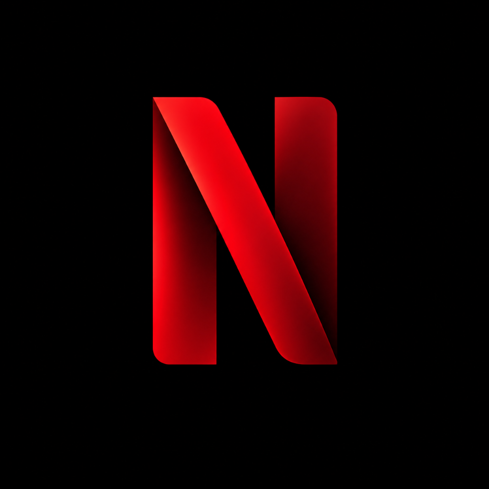

<div align="center">



# NETMIX Android TV
### The Ultimate Streaming Experience Engineered Exclusively for Smart TVs & TV Boxes

[](https://github.com/csbittuzx-oss/netmix-tv-download)
[](https://github.com/csbittuzx-oss/netmix-tv-download)
[](https://github.com/csbittuzx-oss/netmix-tv-download)
[](https://github.com/csbittuzx-oss/netmix-tv-download)

<br/>

<!-- Universal TV Download CTA Button -->
<a href="https://github.com/csbittuzx-oss/netmix-tv-download/raw/main/NetmixTV-latest-universal.apk">
  
</a>
&nbsp;&nbsp;
<a href="https://github.com/csbittuzx-oss/netmix-tv-download/raw/main/NetmixTV-v1.0.0-armeabi-v7a.apk">
  
</a>

<br/><br/>

<p>
  <em>📺 <strong>Universal TV APK</strong>: 100% Guaranteed Compatible with All Android TVs, Google TVs, Fire TV Sticks, and Smart TV Boxes • Multi-ABI Fat Bundle</em><br/>
  <em>⚡ <strong>ARMv7 APK</strong>: Ultra-optimized 28.4 MB build for Mi TV, OnePlus TV, Realme TV, Fire TV Sticks, and budget smart TVs</em>
</p>

</div>

---

## 📺 Direct Download Options

Choose the APK build specifically tailored for your TV hardware:

| Download Option | Architecture | File Size | Recommended TV Devices |
| :--- | :---: | :---: | :--- |
| [**⬇️ Download Universal TV APK**](https://github.com/csbittuzx-oss/netmix-tv-download/raw/main/NetmixTV-latest-universal.apk) *(Recommended)* | `Universal` (`armv7` + `arm64` + `x86_64`) | **~90.9 MB** | ⭐ **100% Compatible with All Android TV & Google TV devices** (Mi TV, Sony Bravia, OnePlus, TCL, Fire TV, Chromecast, Shield TV). Zero setup needed. |
| [**⬇️ Download ARMeabi-v7a APK**](https://github.com/csbittuzx-oss/netmix-tv-download/raw/main/NetmixTV-v1.0.0-armeabi-v7a.apk) | `armeabi-v7a` (32-bit) | **~28.4 MB** | **Mi TV / Xiaomi TV**, Amazon Fire TV Stick, OnePlus TV 32/43", Realme TV, and all 32-bit TV boxes |
| [**⬇️ Download ARM64-v8a APK**](https://github.com/csbittuzx-oss/netmix-tv-download/raw/main/NetmixTV-v1.0.0-arm64-v8a.apk) | `arm64-v8a` (64-bit) | **~31.7 MB** | **Nvidia Shield TV / Shield Pro**, modern Sony Bravia 4K, high-end TCL Google TVs |
| [**⬇️ Download x86_64 APK**](https://github.com/csbittuzx-oss/netmix-tv-download/raw/main/NetmixTV-v1.0.0-x86_64.apk) | `x86_64` (64-bit) | **~36.5 MB** | **Android TV PC Emulators** (Android Studio TV Emulator, BlueStacks, VirtualBox Android x86) |

---

## 🌟 Features Engineered for Big Screen TV

- **Hardware-Accelerated MPV Engine**: Direct hardware video decoding via MediaKit MPV core — zero buffering, instant seek, and 4K HDR playback.
- **Apple tvOS Fluid Interfaces**: Liquid Glass frosted overlays, smooth easeOutCubic focus scaling, and seamless D-pad shelf scrolling.
- **Top 10 Ranked Catalogues**: Real-time trending movies and shows with giant outlined Bebas Neue rank indicators.
- **TMDB 4K Metadata**: Enriched poster art, high-definition backdrop banners, episode stills, and season selectors.
- **Resume Watch Memory**: Instant resume playback saved locally on device with zero cloud latency.
- **Zero Ads & Privacy-First**: 100% local device storage, zero user tracking, and zero advertising SDKs.

---

## 🚀 How to Install NETMIX on Android TV

### Method 1: Via USB Flash Drive (Easiest)
1. Download [**NetmixTV-latest-universal.apk**](https://github.com/csbittuzx-oss/netmix-tv-download/raw/main/NetmixTV-latest-universal.apk) on your computer.
2. Copy the APK onto a USB flash drive.
3. Plug the USB flash drive into your Android TV / Google TV.
4. Open the TV's **File Manager** (or install *FX File Explorer* from Google Play Store).
5. Click on the APK file, enable **"Install from unknown sources"** if prompted, and click **Install**.

### Method 2: Via "Downloader" App on TV
1. On your Android TV or Fire TV, install the free **Downloader** app by AFTVnews from Google Play / Amazon Appstore.
2. In the Downloader URL field, enter the direct download link:
   ```text
   https://github.com/csbittuzx-oss/netmix-tv-download/raw/main/NetmixTV-latest-universal.apk
   ```
3. Click **Go** to download and install automatically.

### Method 3: Via ADB (For Developers / Power Users)
```bash
adb connect <your-tv-ip-address>
adb install -r NetmixTV-latest-universal.apk
```

---

## 🛡️ Security & Integrity Verification

Every build is officially signed with the official Netmix Production Release Key (V1, V2, and V3 signatures) and protected against reverse engineering and tampering with full R8 obfuscation and certificate pinning.

### Official Certificate Fingerprint
```text
Owner: CN=Netmix Security, OU=Netmix Core, O=Netmix Play, C=US
SHA-256: CB:3B:05:DD:8A:E8:EB:6C:B2:7B:3D:84:13:FE:A8:B0:E1:CA:E1:72:7B:0D:83:6C:C0:49:08:72:6C:04:15:D0
```

### Cryptographic Checksums (SHA-256)

| Filename | SHA-256 Checksum | Architecture |
| :--- | :--- | :---: |
| `NetmixTV-latest-universal.apk` | `3EFAD30F0317FDD6A1225B67D2E6BF319797795AD8BB572212895AE006671DF2` | **Universal (All Android TVs)** |
| `NetmixTV-v1.0.0-armeabi-v7a.apk` | `42E7D66D1EC334AA60615A27FAC5F7D53B261FD944A6E19A2456EA7C199E97E2` | `armeabi-v7a` (32-bit TV) |
| `NetmixTV-v1.0.0-arm64-v8a.apk` | `4A08BD10AC3C1D3B424A128692CFED0C44C3E073E7379E578F099B3A29CD21C9` | `arm64-v8a` (64-bit TV) |
| `NetmixTV-v1.0.0-x86_64.apk` | `8D3BD0D8963C75731D3B3A872CC41243F997D1987F2327D1980405EE12849646` | `x86_64` (Emulators) |

---

<div align="center">
  <sub>© 2026 NETMIX Entertainment. All rights reserved.</sub>
</div>
